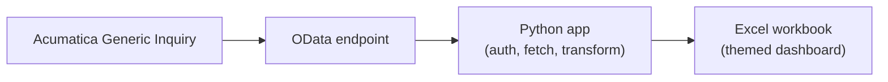
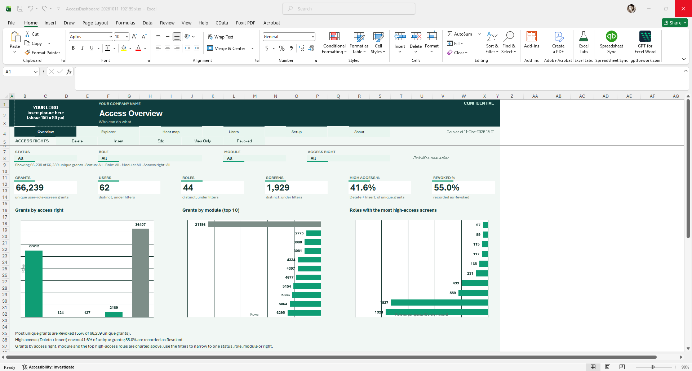
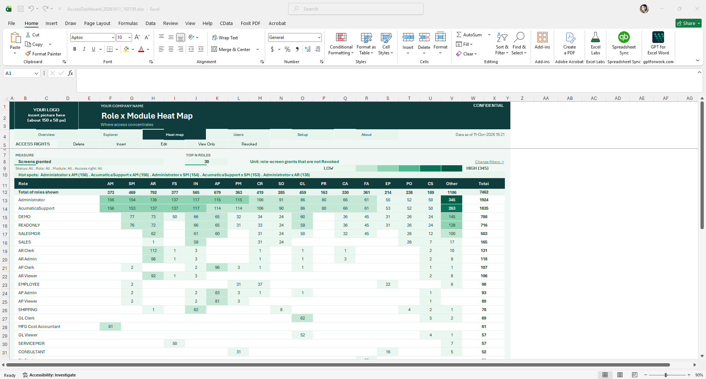
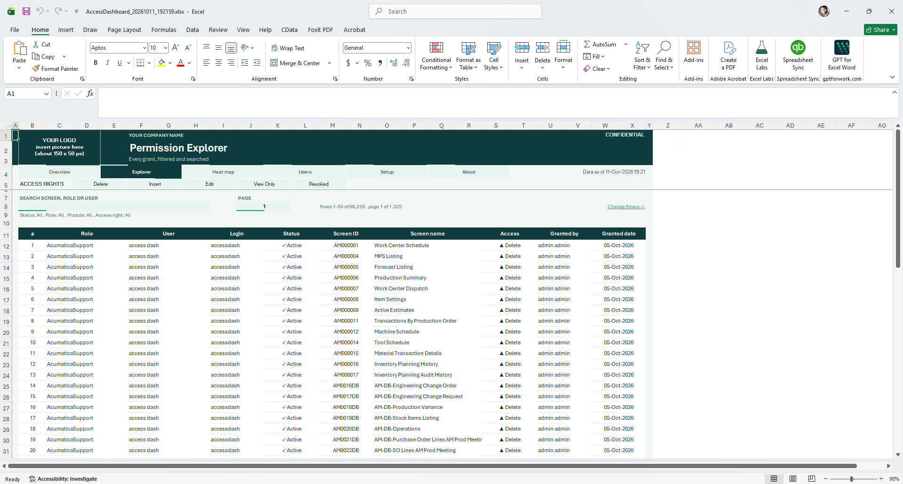
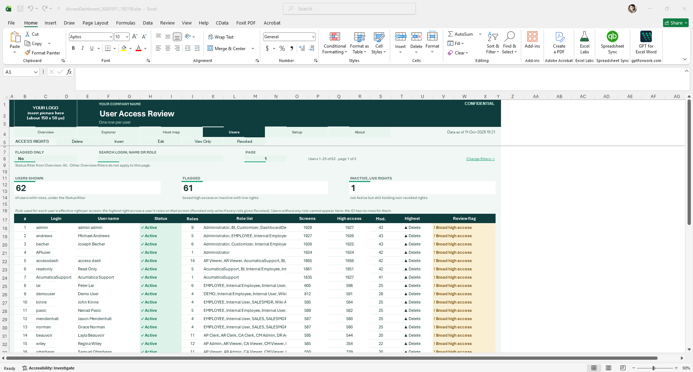

# Acumatica Access Dashboard

**Live Acumatica access-rights dashboard in Excel, delivered as a one-click client kit.**

## The problem

In most Acumatica tenants, nobody can answer a simple question quickly: *who holds which access right, on which screen, and through which role?* The built-in screens show one role or one user at a time. Auditors, controllers and system administrators need the whole picture:

- Who holds a given access right (for example, the highest level) across the company?
- Which users have what access, and which roles give it to them?
- Is the access picture ready for a user access review or an audit?

Access Dashboard answers these questions in a workbook people already know how to use.

## Features

- **Live data** from an Acumatica Generic Inquiry via OData.
- **Excel workbook** with:
  - Overview
  - Explorer
  - Role x Module heat map
  - User Access Review
  - One tab per access right, showing who holds it
- **One-click delivery:** packaged as a single `.exe` with a double-click launcher.
- **Client-controlled:** the client runs it with their own Acumatica credentials and only imports the shipped Generic Inquiry.
- **Security-reviewed build.**

## Architecture

## Tech stack

- Python
- OData / REST
- Acumatica Generic Inquiries
- Excel
- PowerShell launcher
- PyInstaller-style packaging

## Screenshots

| Overview | Role x Module heat map |
|---|---|
|  |  |

| Explorer | User Access Review |
|---|---|
|  |  |

## Roadmap

- Snapshot comparison between two dated workbooks
- Multi-tenant support
- Power Query refresh

## Source code

Source is private (commercial product). A live code walkthrough is available on request.

## Contact

Mohammed Shakil
Email: shakil.rkl@protonmail.com
LinkedIn: https://www.linkedin.com/in/mohammed-shakil-35580a105
